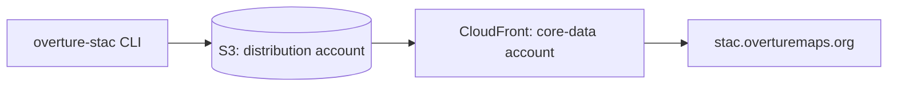

# Publishing architecture

`reconcile.yaml` keeps the production STAC catalog in sync with the release bucket using this repo's own `overture-stac` CLI, validates it, and publishes it to `stac.overturemaps.org`, all without leaving GitHub Actions. `refresh-root.yaml` recomputes derived root state on demand.

## Overall architecture

## Data flow

A `reconcile --apply --validate` run has these stages, always in this order:

1. Diff the release IDs in the catalog against those in the public data bucket.
2. Build each added release locally and validate it before upload; removed releases are dropped from the root first.
3. Upload to S3 under the `stac/` prefix, then rewrite the root `catalog.json` last, so it only ever points at complete releases.
4. Refresh `latest` on the root. With `--generate-latest-ddb` (always passed by the workflows), the CLI first checks that DuckDB runs, before anything is written. When the `latest` release changes, it builds `latest.ddb` (DuckDB views over that release's parquet files) with the DuckDB CLI and uploads it next to `catalog.json`. The root links to it with `rel: alternate`. Without the flag, a changed `latest` removes that link so it never points at an older release. The CLI is found on `PATH` or via `DUCKDB_BIN`; the workflows install a pinned version with `.github/actions/setup-duckdb`.
5. Invalidate the CDN cache in front of the bucket, only if something changed.

Reading the data bucket needs no AWS credentials. Publishing is where the workflow needs to touch two separate AWS accounts, which is the part worth understanding before changing anything here.

## Why two AWS accounts

The bucket that serves `stac.overturemaps.org` and the CloudFront distribution in front of it live in different AWS accounts, split along Overture's existing account boundaries rather than anything specific to this workflow:

- The distribution account owns `overturemaps-extras-us-west-2`, the S3 bucket the catalog is written into under the `stac/` prefix.
- The core-data account owns the CloudFront distribution that fronts `stac.overturemaps.org` and caches what's in that bucket.

## Triggers and gating

`reconcile.yaml` runs hourly on a `schedule` and on `workflow_dispatch`. `refresh-root.yaml` runs on `workflow_dispatch` only. Both refuse to run from any ref other than `main`, and share a `catalog-writer` concurrency group so only one writes `catalog.json` at a time.
